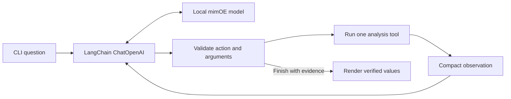

# Wearable-Data Investigation Agent

A local LangChain agent for investigating heart rate, wrist movement, and signal quality in real wearable recordings. It sends natural-language requests and compact tool observations to a model running in **mimOE Studio**. Python calculates and displays the evidence.


The figure uses an attributed PhysioNet recording. See [data provenance and licence](data/README.md).

## Run locally

Use Python 3.11 or newer and [mimOE Studio](https://developer.mimik.com/mimOE-studio-early-access-download-v2). In Studio, connect to the local runtime, select and load the local model in Model View, and open **API** to get its model ID, base URL, and token. Use a model that can pass the action evaluation below. SmolLM2 360M Q2 and Qwen2.5 0.5B Q4 both served live chat on the development Mac. Neither completed the live agent suite reliably. See the [model compatibility results](docs/evaluation.md) before using the interview demo.

```sh
python3 -m venv .venv
source .venv/bin/activate
python -m pip install -r requirements.txt
cp .env.example .env
# Edit .env to match the Studio API panel, then load it.
source .env
python -m wearable.evaluate --smoke
python -m wearable.cli
```

Set `MIMOE_BASE_URL` to the Chat Completions base URL ending in `/v1`. The default is `http://127.0.0.1:8083/mimik-ai/openai/v1`. Use the exact Studio model ID in `MIMOE_MODEL` and the token value without the `Bearer` prefix in `MIMOE_API_KEY`. Keep `.env` private. The application accepts loopback endpoints and disables remote tracing during inference.

## Try it

Choose **Rising heart rate** for an event and **Steadier cycling excerpt** to try the same question on data with no qualifying event. Choose **Different sensor start times** to investigate coverage.

| Example question | What to look for in the trace |
|---|---|
| Check this wearable recording for missing measurements or other data-quality problems. | Signal inspection only. On `offset`, HR is missing from 00:00 to 00:10. |
| Find the most significant periods of elevated heart rate and tell me when they occurred. | Heart-rate statistics, the reference window, and any sustained events. |
| Investigate the largest heart-rate increase. Was it accompanied by increased wrist movement? | Detect events first. If one exists, inspect the accelerometer over its returned interval. |
| Compare the largest heart-rate elevation with the first two minutes. How did heart rate and movement differ? | Detect the event, then compare it with the reference window. |

Enter your own question or a follow-up such as “How much wrist movement was recorded around that first event?” The CLI keeps the last heart-rate findings for the selected recording. Use `r` to select a different recording and `q` to exit.

```sh
python -m wearable.cli --recording offset \
  --question "Compare elapsed minute zero to one with minute one to two."
```

Add `--json` to a single question to inspect full structured results.

## How the agent works



The LLM chooses the next action from the question and prior observations. For example, it can ask for motion evidence after seeing an event ID. The controller validates each action, resolves event IDs against actual results, blocks repeated calls, and limits each turn to six model calls. It allows one repair after an invalid response. A model can choose which tool evidence to display. The final numbers, units, and interpretations of comparison direction come from the executed tools.

| LangChain tool | Deterministic analysis |
|---|---|
| `inspect_signal_quality` | Check available channels, coverage gaps, sample counts, unexpected rates, invalid values, and timestamp issues. |
| `find_heart_rate_events` | Summarize HR and rank sustained recording-relative elevations by peak. |
| `analyze_activity_context` | Compare wrist-motion variability before, during, and after a supplied window or observed event. |
| `compare_intervals` | Compare HR and wrist-motion statistics in two explicit elapsed windows or against the baseline. |

The action protocol uses ordinary Chat Completions text and local Pydantic validation. LangChain provides the model client, message types, and structured tools. This design leaves native function calling and server-enforced JSON optional.

## How to interpret the data

Intervals are half-open and elapsed from the start of an excerpt. The event detector uses the median HR in the first 120 seconds, then looks for at least 20 consecutive seconds at or above baseline plus 10 bpm. This is a transparent demonstration rule for within-recording changes. Missing seconds break runs. Window statistics require at least 10 valid seconds and 80% coverage. The before and after windows are clipped at excerpt boundaries.

The motion feature is one-second RMS acceleration variability after removing the per-axis means. The motion tool reports a higher or lower mean when the absolute change reaches both 0.01 g RMS and 25% of the before mean. Low wrist motion can occur during stationary cycling. Co-occurrence does not establish causation. HR standard deviation describes the exported HR samples and is distinct from beat-to-beat HRV. Motion can also affect the optical HR estimate.

See [data provenance](data/README.md) for sample selection, source hashes, redistribution terms, and the reproducible preparation command.

## Verified results and tests

See [evaluation notes](docs/evaluation.md) for measured outputs, tool traces, and model compatibility. The analysis and scripted controller tests are independent of Studio. The live evaluation checks actual local model responses, including tool arguments, appropriate stopping, and the same movement question on both an event and a no-event recording.

```sh
python -m pip install -r requirements-dev.txt
python -m pytest -q
mkdir -p .source-data
python -m wearable.evaluate --output .source-data/live-evaluation.json
```

The evaluator returns a nonzero exit code when any expected behavior fails. The bundled samples provide example cases for a focused evaluation. Future work could test more recordings, introduce robust local baselines, or extend explicit time-window parsing and comparison across matched sessions.

AI assistance supported implementation and documentation. The repository records tests and measured outcomes separately from planned behavior.
