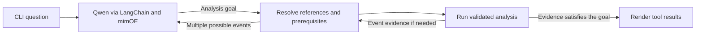

# Wearable-Data Investigation Agent

A bounded AI agent for investigating heart rate, wrist movement, and signal quality in real wearable recordings. A model running in **mimOE Studio** selects an analysis goal from the user's request. Python resolves the inputs, runs the tools, and displays the evidence.


The figure uses an attributed PhysioNet recording. See [data provenance and licence](data/README.md).

## Run locally

Use Python 3.11 or newer and [mimOE Studio](https://developer.mimik.com/mimOE-studio-early-access-download-v2). Connect Studio to the local runtime and load **Qwen2.5-0.5B-Instruct Q4_K_M**. In Model View, open **API** to confirm the model ID and token. The tested ID is `qwen2.5-0.5b-instruct-q4_k_m`. Keep only the model you are testing loaded.

```sh
python3 --version  # Use a Python 3.11+ interpreter.
python3 -m venv .venv
source .venv/bin/activate
python -m pip install -r requirements.txt
test -f .env || cp .env.example .env
# Edit .env to match the Studio API panel, then load it.
set -a
source .env
set +a
python -m wearable.evaluate --smoke
python -m wearable.evaluate
python -m wearable.cli
```

Set `MIMOE_BASE_URL` to the Chat Completions base URL ending in `/v1`. The tested base URL is `http://localhost:8083/mimik-ai/openai/v1`. Use the exact Studio model ID in `MIMOE_MODEL` and the token value without the `Bearer` prefix in `MIMOE_API_KEY`. Keep `.env` private. The application accepts loopback endpoints and disables remote tracing during inference.

## Try it

Choose **Rising heart rate** for an event and **Steadier cycling excerpt** to try the same question on data with no qualifying event. Choose **Different sensor start times** to investigate coverage.

| Example question | What to look for in the trace |
|---|---|
| Check this wearable recording for missing measurements or other data-quality problems. | Signal inspection only. On `offset`, HR is missing from 00:00 to 00:10. |
| Find the most significant periods of elevated heart rate and tell me when they occurred. | Heart-rate statistics, the reference window, and any sustained events. |
| Investigate the largest heart-rate increase. Was it accompanied by increased wrist movement? | Detect events first. If one exists, inspect the accelerometer over its returned interval. |
| Compare the largest heart-rate elevation with the first two minutes. How did heart rate and movement differ? | Detect the event, then compare it with the reference window. |

Enter your own question or a follow-up such as “How much wrist movement was recorded around that first event?” The CLI keeps the last heart-rate findings for the selected recording. Use `r` to select a different recording and `q` to exit.

```sh
python -m wearable.cli --recording offset \
  --question "Contrast minute 0 to 1 with minute 1 to 2 for pulse and motion."
```

Add `--json` to a single question to inspect full structured results.

## mimOE Studio — Capabilities Explored and Design Decisions

Verified on Studio 1.0.38 with runtime 3.30.85.

| Capability | Where it is demonstrated | Why it was selected |
|---|---|---|
| Local model management | **Studio → mimOE → Models** showed Qwen2.5-0.5B-Instruct Q4_K_M loaded on GPU with a 32K context. The **API** button confirmed the loopback base URL. | Use one small, identified model on the test Mac. |
| Authenticated Chat Completions | **Agent.** Uses the local endpoint and the token from the private `.env`. | Keep inference local and verify the model that served each live test. |
| BYO Framework | **Agent.** LangChain sends the completion request and wraps the four Python tools. | Use the existing Python analysis and control tool execution in one place. |
| Direct API probe | **Diagnostic.** Lists models with `GET /models`, then sends one synthetic `POST /chat/completions`. An invalid bearer token returned HTTP 403 during verification. | Check the endpoint, authentication, and model reply independently of LangChain. |
| Inference observability | **Studio and diagnostic.** The Models card shows current and average tokens per second and inference count. The probe reports API token counts, `ttft_ms`, and throughput fields when present, separately from client wall time. | See what the runtime reports and how long the full request takes at the client. |
| Playground | **Studio only.** Sent the synthetic wrist-motion prompt below and observed `motion` with per-turn token counts and timing. | Try a prompt before adding agent instructions, tools, or reference handling. [Studio Playground](https://mimoestudio.mimik.com/features/playground.html) |
| Streaming completions | **Diagnostic.** `--stream` prints text as events arrive and checks for the completion marker. It reports client time to first text, full request time, and any usage supplied by mimOE. | See incremental delivery and distinguish it from waiting for the complete response. |
| Native Studio Trace | **Diagnostic and Studio.** `--trace` sends the synthetic probe through the local model router. Studio showed the matching model, local route, token counts, and span duration. | Confirm which model and node handled an external request. [Studio Trace](https://mimoestudio.mimik.com/features/trace.html) |
| MCP Gateway | **Optional.** Studio registered a local stdio server exposing the existing `inspect_signal_quality` calculation. Authenticated Gateway calls matched Python for all three bundled recordings. | Share one read-only calculation with local clients and scope access at the Gateway. [MCP Gateway](https://mimoestudio.mimik.com/features/gateway.html) |
| Native AI Agent | **Optional, deployed in Studio.** A Qwen agent invoked the scoped Gateway tool in chat. The tool result and reply showed 10 missing heart-rate seconds and zero missing accelerometer seconds on `offset`. | Demonstrate Studio-managed sessions, tool access, and per-call approval. [Native Agents](https://mimoestudio.mimik.com/features/agents.html) |

After the setup above, keep the agent as the main demo. The three diagnostic commands use the same fixed prompt and send no wearable data.

```sh
python -m wearable.cli
python -m wearable.mimoe_api
python -m wearable.mimoe_api --stream
python -m wearable.mimoe_api --trace
```

To repeat the Playground check, open **mimOE → Models → Try** on the active Qwen model. In **params**, leave the system prompt empty, set temperature to `0` and max tokens to `40`, then send:

> Choose one label, heart or motion, for the request: How much did my wrist move? Reply with the label only.

All three diagnostic modes and Playground returned `motion`. That label alone supplies no measurement. In the agent, Python validates Qwen's goal, resolves event or interval references, and limits execution to two tool calls. Deterministic tools calculate the values from the recordings. The API accepts the temperature and token limit, and the probe's client timings exclude model listing. Client time to first text includes delivery through HTTP and can differ from mimOE's `ttft_ms`.

After running `--trace`, open **mimOE → Trace**, select **airouter-v1** and **Last 1h**, and click **Refresh**. In **Conversations**, open `wearable-api-probe`. Look for the latest Qwen completion with node `local` and `54→1` tokens. **Table** shows individual requests. The Studio span duration measures server-side work. API usage reports token counts and runtime metrics, and the probe measures HTTP wall time in Python. Studio can capture prompt and reply text, so this demo uses a fixed synthetic prompt.

The router probe uses the same local setup and credentials as the direct probe. It verifies the loaded model, rejects a matching router alias, and checks that the response came from the local node. No separate tracing setup was needed on the tested runtime. The regular probe and LangChain smoke test used `/mimik-ai/openai/v1` and showed no matching entries under the checked `airouter-v1` filter. The trace probe uses `/mimik-airouter/openai/v1`.

### Optional MCP Gateway and native agent demo

With the local external runtime running, install the optional SDK in the repository's virtual environment with `python -m pip install 'mcp==1.29.0'`. In **mimOE → MCP Gateway → Add server → Paste JSON**, use the checkout's absolute path in both places below. Studio starts the Python process over stdio. The tool accepts only the three bundled recording IDs and returns aggregate signal-quality evidence.

```json
{
  "mcpServers": {
    "wearable-quality": {
      "command": "/ABSOLUTE/CHECKOUT/.venv/bin/python",
      "args": ["-B", "-m", "wearable.mcp_quality"],
      "env": {"PYTHONPATH": "/ABSOLUTE/CHECKOUT"}
    }
  }
}
```

Expand the connected server to see `inspect_signal_quality`. On macOS, the Studio-bundled runtime CLI can list and call the tool using its local Gateway credentials. Use the Studio port if it differs from `8083`.

```sh
runtime='/Applications/mimOE Studio.app/Contents/Resources/runtime-bundle-signed/bin/mimoe'
"$runtime" mcp tools --host 127.0.0.1 --port 8083 --json
"$runtime" mcp call wearable-quality__inspect_signal_quality '{"recording":"offset"}' \
  --host 127.0.0.1 --port 8083 --json
```

For the native chat path, open **Agents → New agent**, select the same local Qwen, name it `wearable-quality-demo`, choose an empty directory you own, and deploy. In the agent's **MCP Servers → Edit access**, uncheck its Bash server, check only `wearable-quality`, and save. Studio manages the scoped client key. In **New chat**, send the request below. Approve once when the card shows `wearable-quality__inspect_signal_quality` and `{"recording":"offset"}`.

> Call the inspect_signal_quality tool once with recording set to "offset". Then report only the missing seconds for heart rate and accelerometer, and the heart-rate gap interval. Use the tool result as evidence.

Check the expanded tool result for `heart_rate.missing_s = 10`, `heart_rate.largest_gaps_s = [[0, 10]]`, and `accelerometer.missing_s = 0` under `signals`. Use the tool result as evidence. The native agent successfully invoked the scoped MCP tool in three chat tests, returning the expected missing-second counts. The primary LangChain agent uses deterministic Python rendering to report physiological measurements directly from validated tool results.

Direct JSON-RPC checks at `/mcp/v1/mcp` returned HTTP 401 for missing and invalid keys. The agent's scoped key listed only this tool, rejected an out-of-scope Bash call, and returned the same reports as Python. An invalid recording ID was rejected.

The optional path makes the calculation available to other local clients and lets Studio manage deployment, sessions, and permissions. The primary BYO CLI keeps tool calls in process and enforces event references, a two-call limit, and deterministic rendering in Python. The native chat demo exercises one calculation. It adds a server process, a deployment, and an approval step.

### Benchmark investigation

In **mimOE → Benchmark**, selecting `wearable-quality-demo` enabled benchmark mode on that deployment. Studio ran its built-in `light — ls` workload against the local Qwen with `THINKING_MODE=none`. The one-session Real model run finished in 2.3 s at 23.7 tokens/s, with 341 ms to first word and **0/1 verified**. The session showed a successful `ls` call, but Qwen returned `DONE` instead of `1:DONE` after a retry. A two-session run was stopped after about 90 s without a completed result.

A two-session Mock GPU control used four simulated slots, 800 ms per inference, three tool turns per session, and 500 ms affinity grace. It ended in 5.2 s with **0/2 verified**. Both sessions showed a harness error. The error `identifier 'process' undefined` persisted on retry after adding the expected `scratch/` directory and `AGENTS.md` to the test workspace. Benchmark is useful for capacity testing a native deployment with a verified workload. These runs used Studio's synthetic workload and did not measure the wearable tool or the BYO CLI. [Studio Benchmark](https://mimoestudio.mimik.com/features/bench.html)

| Considered | Why it was excluded |
|---|---|
| Native Benchmark | Tested Real model and Mock GPU on the demo deployment. The installed view offered built-in workloads and required a deployed agent. Neither mode produced a verified run, so the demo uses the CLI evaluation for wearable correctness and the probes for request timing. |
| Model aliases | Inspected **Models → Alias models**. The router can resolve a stable alias to a model, which helps when switching backends. The demo pins the loaded Qwen model for repeatability. Alias resolution was outside this demo. [Models and aliases](https://mimoestudio.mimik.com/features/models.html) |
| Embeddings and retrieval | Reviewed the documentation. Analysis reads selected recording intervals directly. [Inference](https://developer.mimik.com/docs/ai-foundation/inference) |
| Providers, multiple models, and remote or mesh inference | Reviewed the documentation. One local model serves the demo without another backend or device. [Providers](https://mimoestudio.mimik.com/features/providers.html), [Mesh](https://mimoestudio.mimik.com/features/mesh.html) |
| Studio Logs | Inspected the live stream. The Models card, Trace, and probe provide the request and timing evidence used here. |

## How the agent works



Qwen chooses a goal such as signal quality, heart-rate events, wrist movement, or comparison. Python extracts literal elapsed-time windows and validates them. If a selected goal needs an event, the controller reuses the latest search for that recording or runs a prerequisite search. An empty search ends the investigation with the available evidence. With two observed events and an explicit earlier/later reference, Qwen receives both IDs labeled by time order and chooses one. Python checks the choice against the observed times and asks for clarification if the reference is ambiguous or the choice conflicts with it.

Each turn allows at most two tool executions and blocks identical calls. The controller ends the turn when the requested analysis has run or when a required reference is unavailable. The CLI labels steps as **model goal** or **prerequisite** and renders values and limitations from actual tool results.

| LangChain tool | Deterministic analysis |
|---|---|
| `inspect_signal_quality` | Check available channels, coverage gaps, sample counts, unexpected rates, invalid values, and timestamp issues. |
| `find_heart_rate_events` | Summarize HR and rank sustained recording-relative elevations by peak. |
| `analyze_activity_context` | Compare wrist-motion variability before, during, and after a supplied window or observed event. |
| `compare_intervals` | Compare HR and wrist-motion statistics in two explicit elapsed windows or against the baseline. |

LangChain's `ChatOpenAI` sends ordinary Chat Completions to mimOE. Chat messages carry the goal prompt and examples, and `ChatPromptTemplate` formats the event choices. The controller calls LangChain `StructuredTool.invoke` with arguments checked by Pydantic. Keeping argument resolution and stopping in Python reduced the number of decisions the local model had to make on each turn. For an explicit window, use numeric seconds, numeric minutes, or MM:SS ranges. For a comparison against the start of the excerpt, a phrase like “first two minutes” also works.

## How to interpret the data

Intervals are half-open and elapsed from the start of an excerpt. The event detector uses the median HR in the first 120 seconds, then looks for at least 20 consecutive seconds at or above baseline plus 10 bpm. This is a transparent demonstration rule for within-recording changes. Missing seconds break runs. Window statistics require at least 10 valid seconds and 80% coverage. The before and after windows are clipped at excerpt boundaries.

The motion feature is one-second RMS acceleration variability after removing the per-axis means. The motion tool reports a higher or lower mean when the absolute change reaches both 0.01 g RMS and 25% of the before mean. Low wrist motion can occur during stationary cycling. Co-occurrence does not establish causation. HR standard deviation describes the exported HR samples and is distinct from beat-to-beat HRV. Motion can also affect the optical HR estimate.

See [data provenance](data/README.md) for sample selection, source hashes, redistribution terms, and the reproducible preparation command.

## Verified results and tests

The bounded controller passed **11/11 original live cases** with Qwen2.5 0.5B and all four guided CLI prompts. The same movement request succeeded three times per recording on `rising` and `steady`. Python used the event result to determine whether to run the requested follow-up. In four separate live tests with synthetic recordings, Qwen selected the correct earlier or later observed event ID, including when swapping the peaks swapped the IDs. Two of three additional paraphrases passed. Qwen declined “Did either channel miss any samples?” as unsupported. See the [evaluation notes](docs/evaluation.md) and [recorded CLI walkthrough](docs/live-qwen-0.5b-review-cli.txt).

```sh
python -m pip install -r requirements-dev.txt
python -m pytest -q
mkdir -p .source-data
python -m wearable.evaluate --output .source-data/live-evaluation.json
```

Use `--extended` to repeat the paired demo, try three additional phrasings, and run the synthetic event-choice checks. It returns a nonzero exit code if any additional case fails. The checks cover a small collection of prompts and recordings. The model can still misclassify unfamiliar phrasings.


