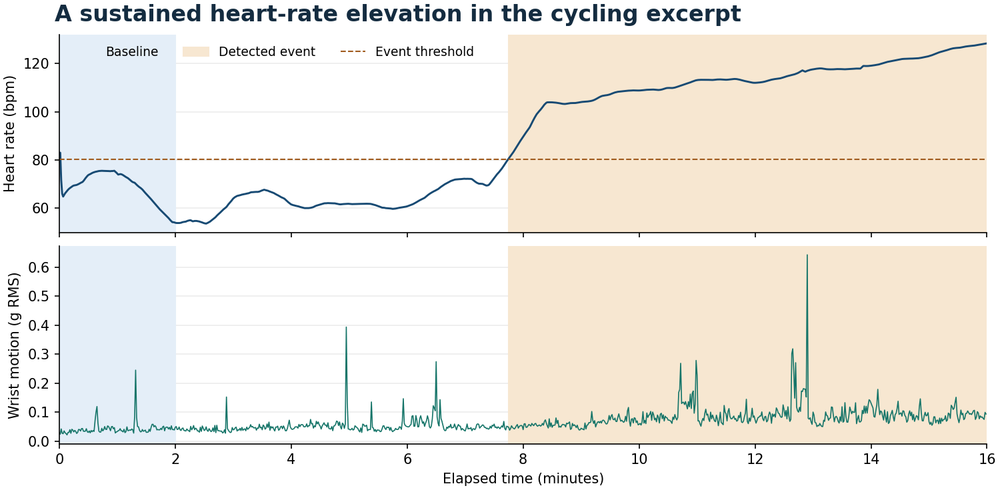
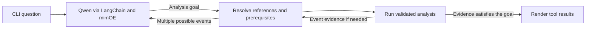

# Wearable-Data Investigation Agent

A bounded AI agent for investigating heart rate, wrist movement, and signal quality in real wearable recordings. A model running in **mimOE Studio** selects an analysis goal from the user's request. Python resolves the inputs, runs the tools, and displays the evidence.



The figure uses an attributed PhysioNet recording. See [data provenance and licence](data/README.md).

## Run locally

Use Python 3.11 or newer and [mimOE Studio](https://developer.mimik.com/mimOE-studio-early-access-download-v2). Connect Studio to the local runtime and load **Qwen2.5-0.5B-Instruct Q4_K_M**. In Model View, open **API** to confirm the model ID and token. The tested ID is `qwen2.5-0.5b-instruct-q4_k_m`. Keep only the model you are testing loaded.

```sh
python3 --version  # Use a Python 3.11+ interpreter.
python3 -m venv .venv
source .venv/bin/activate
python -m pip install -r requirements.txt
test -f .env || cp .env.example .env
# Edit .env to match the Studio API panel, then load it.
source .env
python -m wearable.evaluate --smoke
python -m wearable.evaluate
python -m wearable.cli
```

Set `MIMOE_BASE_URL` to the Chat Completions base URL ending in `/v1`. The tested base URL is `http://localhost:8083/mimik-ai/openai/v1`. Use the exact Studio model ID in `MIMOE_MODEL` and the token value without the `Bearer` prefix in `MIMOE_API_KEY`. Keep `.env` private. The application accepts loopback endpoints and disables remote tracing during inference.

## Try it

Choose **Rising heart rate** for an event and **Steadier cycling excerpt** to try the same question on data with no qualifying event. Choose **Different sensor start times** to investigate coverage.

| Example question | What to look for in the trace |
|---|---|
| Check this wearable recording for missing measurements or other data-quality problems. | Signal inspection only. On `offset`, HR is missing from 00:00 to 00:10. |
| Find the most significant periods of elevated heart rate and tell me when they occurred. | Heart-rate statistics, the reference window, and any sustained events. |
| Investigate the largest heart-rate increase. Was it accompanied by increased wrist movement? | Detect events first. If one exists, inspect the accelerometer over its returned interval. |
| Compare the largest heart-rate elevation with the first two minutes. How did heart rate and movement differ? | Detect the event, then compare it with the reference window. |

Enter your own question or a follow-up such as “How much wrist movement was recorded around that first event?” The CLI keeps the last heart-rate findings for the selected recording. Use `r` to select a different recording and `q` to exit.

```sh
python -m wearable.cli --recording offset \
  --question "Contrast minute 0 to 1 with minute 1 to 2 for pulse and motion."
```

Add `--json` to a single question to inspect full structured results.

## How the agent works



Qwen chooses a goal such as signal quality, heart-rate events, wrist movement, or comparison. Python extracts literal elapsed-time windows and validates them. If a selected goal needs an event, the controller reuses the latest search for that recording or runs a prerequisite search. An empty search ends the investigation with the available evidence. With two observed events and an explicit earlier/later reference, Qwen receives both IDs labeled by time order and chooses one. Python checks the choice against the observed times and asks for clarification if the reference is ambiguous or the choice conflicts with it.

Each turn allows at most two tool executions and blocks identical calls. The controller ends the turn when the requested analysis has run or when a required reference is unavailable. The CLI labels steps as **model goal** or **prerequisite** and renders values and limitations from actual tool results.

| LangChain tool | Deterministic analysis |
|---|---|
| `inspect_signal_quality` | Check available channels, coverage gaps, sample counts, unexpected rates, invalid values, and timestamp issues. |
| `find_heart_rate_events` | Summarize HR and rank sustained recording-relative elevations by peak. |
| `analyze_activity_context` | Compare wrist-motion variability before, during, and after a supplied window or observed event. |
| `compare_intervals` | Compare HR and wrist-motion statistics in two explicit elapsed windows or against the baseline. |

LangChain's `ChatOpenAI` sends ordinary Chat Completions to mimOE. Chat messages carry the goal prompt and examples, and `ChatPromptTemplate` formats the event choices. The controller calls LangChain `StructuredTool.invoke` with arguments checked by Pydantic. Keeping argument resolution and stopping in Python reduced the number of decisions the local model had to make on each turn. For an explicit window, use numeric seconds, numeric minutes, or MM:SS ranges. For a comparison against the start of the excerpt, a phrase like “first two minutes” also works.

## How to interpret the data

Intervals are half-open and elapsed from the start of an excerpt. The event detector uses the median HR in the first 120 seconds, then looks for at least 20 consecutive seconds at or above baseline plus 10 bpm. This is a transparent demonstration rule for within-recording changes. Missing seconds break runs. Window statistics require at least 10 valid seconds and 80% coverage. The before and after windows are clipped at excerpt boundaries.

The motion feature is one-second RMS acceleration variability after removing the per-axis means. The motion tool reports a higher or lower mean when the absolute change reaches both 0.01 g RMS and 25% of the before mean. Low wrist motion can occur during stationary cycling. Co-occurrence does not establish causation. HR standard deviation describes the exported HR samples and is distinct from beat-to-beat HRV. Motion can also affect the optical HR estimate.

See [data provenance](data/README.md) for sample selection, source hashes, redistribution terms, and the reproducible preparation command.

## Verified results and tests

The bounded controller passed **11/11 original live cases** with Qwen2.5 0.5B and all four guided CLI prompts. The same movement request succeeded three times per recording on `rising` and `steady`. Python used the event result to determine whether to run the requested follow-up. In four separate live tests with synthetic recordings, Qwen selected the correct earlier or later observed event ID, including when swapping the peaks swapped the IDs. Two of three additional paraphrases passed. Qwen declined “Did either channel miss any samples?” as unsupported. See the [evaluation notes](docs/evaluation.md) and [recorded CLI walkthrough](docs/live-qwen-0.5b-review-cli.txt).

```sh
python -m pip install -r requirements-dev.txt
python -m pytest -q
mkdir -p .source-data
python -m wearable.evaluate --output .source-data/live-evaluation.json
```

Use `--extended` to repeat the paired demo, try three additional phrasings, and run the synthetic event-choice checks. It returns a nonzero exit code if any additional case fails. The checks cover a small collection of prompts and recordings. The model can still misclassify unfamiliar phrasings.

AI assistance supported implementation and documentation. The repository records tests and measured outcomes separately from planned behavior.
